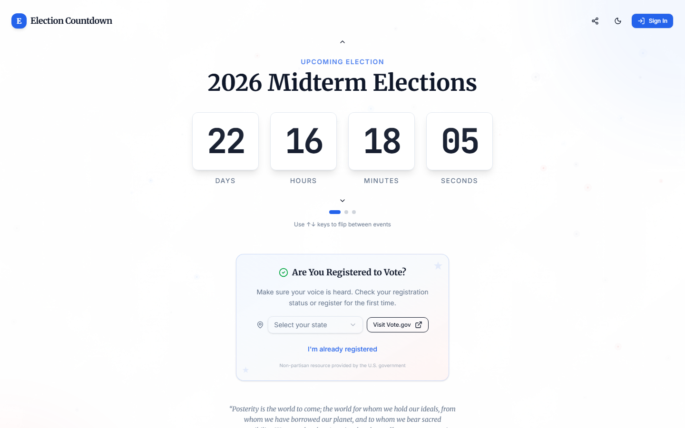
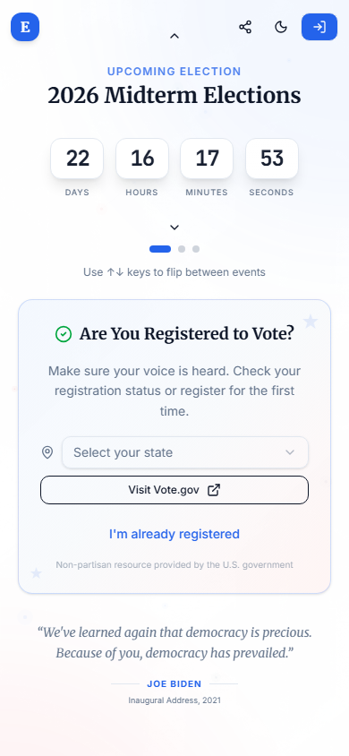
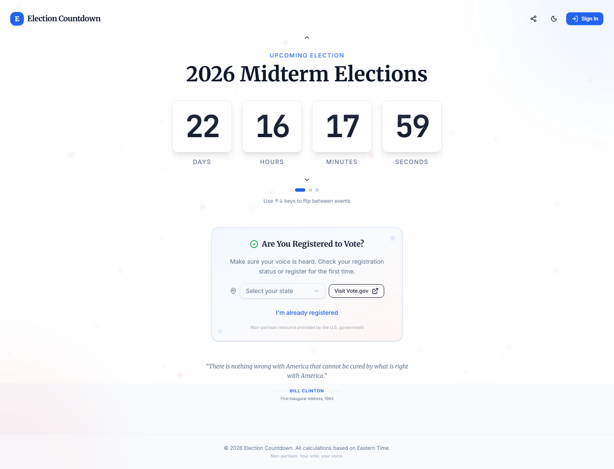

# Election Countdown

Live countdown to the 2026 Midterms and 2028 Presidential Election: voter registration links, per-election vote plans (with or without an account), Google/GitHub sign-in, themes for verified accounts, and an admin analytics dashboard with exports and a nightly data pipeline.

Live at **https://electionclock.com** (the old `election-countdown-38g.pages.dev` address and `www` redirect there).

## Screenshots

**Desktop**



**Mobile**



**Full page**



## Run locally

```bash
npm ci
cp .dev.vars.example .dev.vars
npm run dev:full     # site + API + local database on http://localhost:8788
```

See [SETUP.md](SETUP.md) for running the full stack locally (API + D1 included).

## Build and deploy

```bash
npm run build:site          # vite build -> public/assets, repoints public/index.html
npx wrangler pages deploy   # publishes public/ + functions/ only
```

Database changes ship as files in `migrations/`; apply them to production **before** deploying
code that needs them (see [LAUNCH.md](LAUNCH.md)).

## Embed the countdown

Any site can show the live countdown with one line. Every embed links back to electionclock.com.

```html
<iframe src="https://electionclock.com/embed.html?election=midterm-2026" width="320" height="140" style="border:0" title="Election Countdown" loading="lazy"></iframe>
```

Query parameters: `election=midterm-2026|presidential-2028` (default: the next upcoming election)
and `theme=light|dark` (default light). The snippet is also in the site's share dialog under "Embed".

## State voting dates

`client/public/data/state-voting-2026.json` (served at `/data/state-voting-2026.json`) holds,
for all 50 states + DC, the registration deadlines (online / mail / in person, plus
same-day registration), the in-person early voting window and the mail-ballot request and
return deadlines for the November 3, 2026 general election. The "Are You Registered" card
reads it once after a visitor picks their state and renders the "Key dates" block.

Sourcing rule, non-negotiable: every date in the file was read from an official page that was
actually fetched (the state's Secretary of State / election board site, vote.gov or NCSL) and
each state records that page in `source.url` / `source.title` with the day it was read in
`source.checkedOn`. A field that the official page does not print as an absolute 2026 date is
`null` with a short `note` (the UI shows "Check your state's site"). Dates are never computed
from a rule like "29 days before Election Day" and never taken from memory or third-party
sites.

To refresh: open each state's `source.url`, compare, update the dates and set that state's
`source.checkedOn` to the day you checked (and `generatedOn` at the top). Then `npm run build`
(the served copy in `public/` must match) and `npm run test:e2e`: the `state voting dates`
suite validates the schema and date ranges, checks that every `source.url` still answers,
and drives the UI for Georgia.

## Tests

```bash
npx playwright install chromium   # first time only
npm run test:e2e
```

Starts a local `wrangler pages dev` with an empty database and runs every suite against it
(about 2–3 minutes): database migration, deploy-folder contents, per-election votes, CSV
export safety, rate limits, request volume per visitor, arrow keys, Election Day behaviour at
fixed times, and voting on the 2028 card. Run it before every deploy. The tests refuse to run
against `*.pages.dev`.
